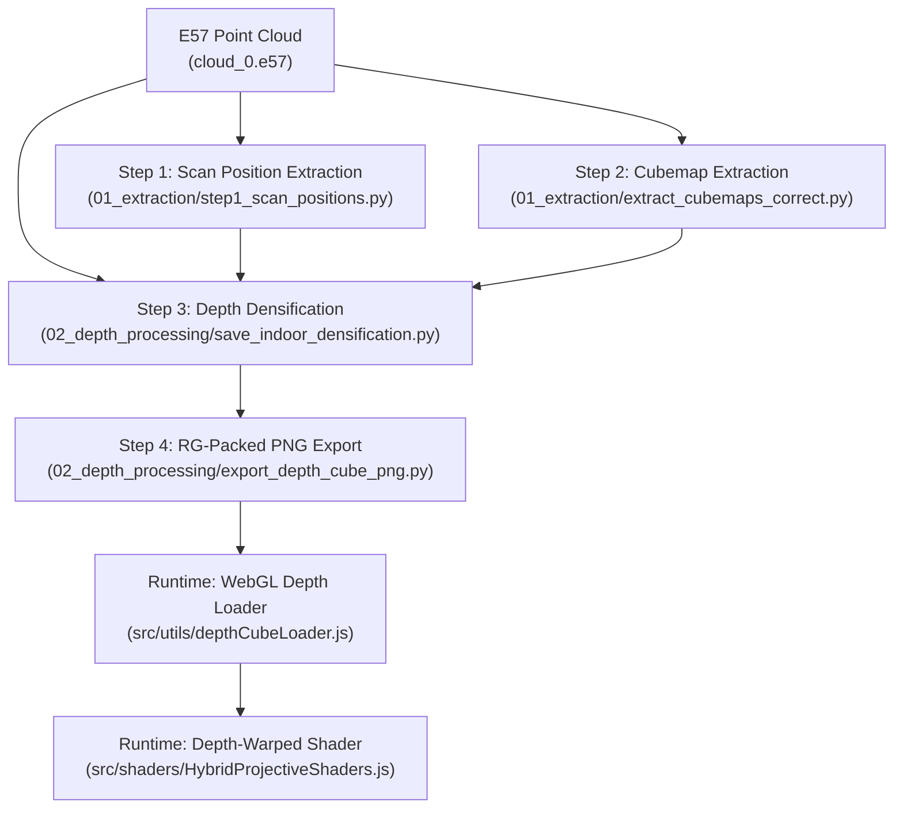

# Depth Map Extraction Pipeline — Detailed Explanation

This document traces the complete depth map pipeline from raw E57 point cloud data through to runtime WebGL consumption.

---

## High-Level Architecture



---

## Stage 1 — Scan Position Extraction

**Script:** [step1_scan_positions.py](file:///d:/3d-viewer/scripts/01_extraction/step1_scan_positions.py)

This is the foundation step. It reads the E57 file's probe results and produces a clean `scan_positions.json` that all downstream stages reference.

### What it does:
1. Reads [e57_probe_results.json](file:///d:/3d-viewer/public/data/e57_probe_results.json) containing raw scan metadata
2. **Classifies each scan by floor level** using scanner Z height:
   - `z < 2.0m` → Ground Floor (floor 0)
   - `2.0m ≤ z < 3.5m` → Staircase/Transition (floor -1)
   - `z ≥ 3.5m` → Upper Floor (floor 1)
3. **Reads exact structured grid dimensions** directly from the E57 file by inspecting `rowIndex` and `columnIndex` fields of the first scan
4. Outputs position (x,y,z), rotation quaternion, floor level, point count, and feature flags for each scan

### Key output:
- `public/data/scan_positions.json` — the canonical scan registry used by every subsequent script

---

## Stage 2 — Cubemap Face Extraction

**Script:** [extract_cubemaps_correct.py](file:///d:/3d-viewer/scripts/01_extraction/extract_cubemaps_correct.py)

This script extracts the **6 pinhole camera images** embedded in each E57 scan as cubemap faces, and correctly identifies which face corresponds to which axis direction.

### Process:
1. Opens the E57 file and iterates over the `images2D` node (6 images per scan)
2. For each image:
   - Reads its **pose quaternion** from the E57 metadata
   - Computes the image's **global forward direction** by rotating `[0,0,1]` by the pose quaternion
   - Converts to **scanner-local space** by applying the inverse of the scan header's rotation
   - Classifies the dominant axis (±X, ±Y, ±Z) to determine which cubemap face it is
3. Extracts the raw JPEG/PNG image blob from the E57 representation node
4. Applies **canonical transforms** via the shared [cubemap_transforms.py](file:///d:/3d-viewer/scripts/core/cubemap_transforms.py) module
5. Saves corrected face images as `scan_{idx}_{face}.jpg` (e.g., `scan_0_px.jpg`)

### Canonical Transform Module

The shared [cubemap_transforms.py](file:///d:/3d-viewer/scripts/core/cubemap_transforms.py) applies a **two-step, load-bearing transform order**:

1. **Set A Rotations** — empirically derived 90°-multiple rotations per face to correct the raw Matterport pinhole orientations:
   | Face | Rotation (CW) |
   |------|---------------|
   | +X   | 90°           |
   | -X   | 270°          |
   | +Y   | 0°            |
   | -Y   | 180°          |
   | +Z   | 270°          |
   | -Z   | 270°          |

2. **Z-Inversion Flips** — corrects the coordinate system handedness:
   - ±X faces → horizontal flip
   - ±Y faces → vertical flip
   - ±Z faces → **swap** (+Z ↔ -Z) plus horizontal flip

> [!IMPORTANT]
> This transform order is **load-bearing**. Both the color and depth pipelines go through the exact same [apply_canonical_transforms](file:///d:/3d-viewer/scripts/core/cubemap_transforms.py#L89-L97) function, guaranteeing pixel-perfect alignment between color and depth cube faces.

All rotations use `np.rot90` and `np.flip` — **no interpolation** — ensuring lossless permutation of values, which is critical for metric depth data.

---

## Stage 3 — Depth Densification (The Core Depth Extraction)

**Script:** [save_indoor_densification.py](file:///d:/3d-viewer/scripts/02_depth_processing/save_indoor_densification.py)

This is the **heart of the depth pipeline**. It reconstructs dense, high-resolution (4096×4096) depth cubemap faces by projecting 3D point cloud data onto the exact camera planes defined in the E57 metadata.

### Algorithm:

#### 3.1 — Camera Pose Recovery
For the target scan, the script:
1. Reads the **6 pinhole camera poses** from `images2D` (same as the color extraction)
2. Computes each camera's global-to-local inverse transform
3. Identifies which cubemap face each camera corresponds to (same dominant-axis classification)

#### 3.2 — Neighbor Discovery
Finds all scans within a **5-meter radius** of the target scan to use as supplementary depth sources. This is the "densification" — filling gaps from the target scan's point cloud with nearby scans.

#### 3.3 — Two-Pass Point Projection

**Pass 1 — Depth population with provenance tracking:**

For each scan (target + neighbors), for each cubemap face:
1. Reads raw `cartesianX/Y/Z` from the E57 scan, filtering out `invalidState ≠ 0`
2. Transforms points to **global coordinates** using the scan header's rotation matrix and translation
3. Projects into the target camera's coordinate frame: `pts_camera = (pts_global - cam_translation) @ inv_cam_rotation^T`
4. Performs **perspective projection** onto a 4096×4096 grid:
   ```
   px = round((cx / -cz) * 2048 + 2048)
   py = round((-cy / -cz) * 2048 + 2048)
   ```
   Note: `cz < 0` means the point is in front of the camera (outward-looking convention)
5. Computes **radial distance** (Euclidean distance from camera center): `r = sqrt(cx² + cy² + cz²)`
6. Applies a **painter's algorithm** (sorts by distance, paints far-to-near) with provenance rules:
   - **Target scan points** (provenance = 1, "native"): always overwrite if closer
   - **Neighbor points** (provenance = 2, "filled"):
     - If the pixel already has a target-scan depth within 4cm tolerance → **corroborate** (take the closer measurement)
     - If the pixel is empty → **fill** the gap

**Pass 2 — Confidence scoring:**

Re-projects all scans and counts how many independent measurements agree (within ±4cm "tie epsilon") with the final winning depth at each pixel. Fills that into a `conf_faces` counter:
- Confidence 0 = filled from neighbor only
- Confidence 1 = native (target scan only)
- Confidence 2+ = corroborated by multiple scans

#### 3.4 — Canonical Transforms
Applies the **same** [apply_canonical_transforms](file:///d:/3d-viewer/scripts/core/cubemap_transforms.py#L89-L97) to depth, provenance, and confidence arrays, ensuring perfect alignment with the color cubemap.

#### 3.5 — Normalization and Serialization
1. Computes the **global per-scan min/max depth** across all 6 faces
2. Normalizes float32 metric depth to **uint16 range [1, 65535]** (0 is reserved for invalid):
   ```python
   d_norm = round(1 + 65534 * (depth - global_min) / (global_max - global_min))
   ```
3. Saves each face as a compressed `.npz` file containing:
   - `depth` (uint16): normalized depth
   - `confidence` (uint8): confidence tier
   - `valid_mask` (bool): which pixels have valid depth
   - `provenance` (JSON string): metadata including `depth_min_m` and `depth_max_m` for runtime reconstruction

### Output:
- `public/depth_cubemap_uint16/scan_{id}_{face}.npz` — lossless master files (4096² per face)
- Alongside `.json` sidecar files with per-face metadata

### Verification:
The script includes a built-in **verification phase** that:
- Asserts dtype correctness (uint16, uint8, bool)
- Validates mask consistency (`valid_mask == (depth > 0)`)
- Confirms invariant: confidence > 0 ⟹ depth > 0
- Round-trips the uint16 ↔ float32 conversion and measures **max quantization error** (sub-millimeter, typically < 0.01 cm)

---

## Stage 4 — RG-Packed PNG Export (Runtime Format)

**Script:** [export_depth_cube_png.py](file:///d:/3d-viewer/scripts/02_depth_processing/export_depth_cube_png.py)

Converts the lossless `.npz` masters into **standard 8-bit RGBA PNGs** that can be loaded by `THREE.CubeTextureLoader` in the browser.

### Encoding scheme:

| Channel | Content                           |
|---------|-----------------------------------|
| **R**   | High byte of depth uint16 (`>> 8 & 0xFF`) |
| **G**   | Low byte of depth uint16 (`& 0xFF`)       |
| **B**   | Confidence tier (0=filled, 1=native, 2+=corroborated) |
| **A**   | Valid mask (255 = valid, 0 = hole)         |

This **RG split is mathematically lossless** for uint16 values: `depth16 = R×256 + G`, reconstructing the full 16-bit range from two 8-bit channels.

### Outputs:
- `public/depth_cube/scan_{id}_{face}.png` — runtime-ready depth faces
- `public/depth_cube/depth_ranges.json` — per-scan metric min/max for shader reconstruction

---

## Stage 5 — Runtime: Frontend Depth Consumption

### 5a. Depth Cube Loader

**Module:** [depthCubeLoader.js](file:///d:/3d-viewer/src/utils/depthCubeLoader.js)

Loads the 6 depth PNGs as a `THREE.CubeTexture` with critical settings:
- `NearestFilter` (no interpolation — packed bytes are data, not color)
- `NoColorSpace` (no sRGB conversion — would corrupt the packed integers)
- No mipmaps
- **Face ordering** is derived from the same `scan_metadata.json` used by the color pipeline, guaranteeing depth and color cube faces match

Includes a cache (`Map`) to avoid redundant loads.

### 5b. Depth-Warped Panorama Shader ("The Magic Bubble")

**Module:** [HybridProjectiveShaders.js](file:///d:/3d-viewer/src/shaders/HybridProjectiveShaders.js) — `DepthWarpedPanoramaShader`

This GLSL shader performs real-time **6-degree-of-freedom (6DOF) parallax** by physically displacing the vertices of a subdivided box geometry using the depth cubemap.

#### Vertex Shader:
```glsl
// 1. Object-space direction = scanner-local frame
vec3 localDir = normalize(position);

// 2. Sample depth cube with explicit LOD (vertex stage requires textureLod)
vec4 packed = textureLod(uDepthCube, localDir, 0.0);

// 3. Reconstruct uint16 from RG channels
float hi = floor(packed.r * 255.0 + 0.5);
float lo = floor(packed.g * 255.0 + 0.5);
float depth16 = hi * 256.0 + lo;

// 4. Convert normalized depth to metric meters
float norm = depth16 / 65535.0;
float depthMeters = uMinDepth + norm * (uMaxDepth - uMinDepth);

// 5. Invalid pixels → push to max depth (background shell)
if (valid < 0.5 || depth16 <= 0.0) depthMeters = uMaxDepth;

// 6. Displace vertex along its direction
vec3 displacedPosition = localDir * depthMeters;
```

#### Fragment Shader:
Samples the **native color cubemap** in the same scanner-local direction, ensuring the projected color aligns exactly with the depth displacement.

---

## End-to-End Data Flow Summary

```
E57 Cloud → [Raw 3D points + camera poses]
    ↓
Step 1: Scan position registry (scan_positions.json)
    ↓
Step 2: Color cubemap extraction → canonical transforms → JPG faces
    ↓
Step 3: Depth densification
    │  ├─ Project target scan's points onto 4096² pinhole planes
    │  ├─ Fill gaps with neighbor scans (≤5m radius)
    │  ├─ Score confidence (native / filled / corroborated)
    │  ├─ Apply identical canonical transforms
    │  └─ Normalize to uint16 [1,65535] → save .npz masters
    ↓
Step 4: Pack uint16 into RGBA PNG (R=hi, G=lo, B=conf, A=mask)
    ↓
Step 5: Browser loads CubeTexture → vertex shader unpacks → 6DOF parallax
```

> [!TIP]
> The key design insight is that **depth and color share the exact same cubemap face alignment** through the shared [cubemap_transforms.py](file:///d:/3d-viewer/scripts/core/cubemap_transforms.py) module. This means the vertex shader can sample depth in one cube direction and the fragment shader can sample color in the same direction, and they will always correspond to the same physical point.
